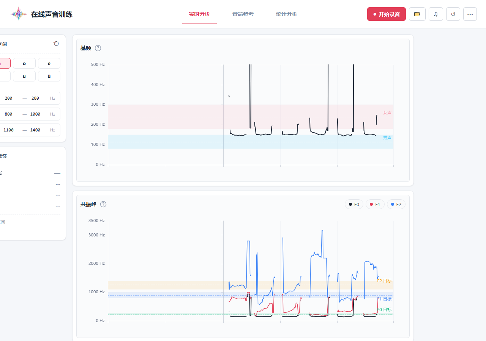
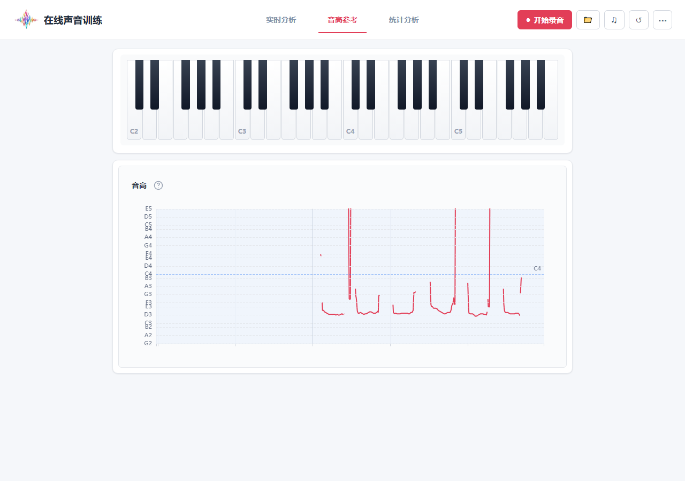

# Voice Builder

实时分析语音音高, 共振峰, 专为伪音练习设计.


## Quick Start

克隆本仓库
```bash
  git clone https://github.com/JPs-git/voice-builder.git
  cd voice-builder
```
安装依赖启动开发服务器
```bash
  npm install
  npm run dev
```

## Features

- 实时显示音高、共振峰
- 回放自己的声音
- 支持上传wav文件分析
- 独立「统计分析」页（`/recording`）：自然朗读或自由说话，最多 60 秒，录音时仅显示材料与计时，录后分析整段音频。
- 统计典型 F0（中位数）、最高/最低 F0、变化幅度与半音跨度，提供时间曲线、分布与极值附近回听。

实时分析与音高参考继续使用 10 秒音频窗口；统计分析支持录音或导入不超过 60 秒的片段。录音与报告仅在浏览器当前会话内保留，刷新后清除。有效 F0 少于 3 秒时不显示摘要值；3–10 秒显示样本较少提示。统计反映本段说话，不代表个人完整音域。


## 匿名使用统计

自行部署默认关闭统计。正式站点可按 [统计接入说明](docs/analytics.md) 配置 Umami Cloud。录音和声音分析数据在本地处理，不发送给统计服务。

## Skills
- Javascript
- HTML
- CSS
- Echarts

## Screenshots



## License

[MIT](https://choosealicense.com/licenses/mit/)


